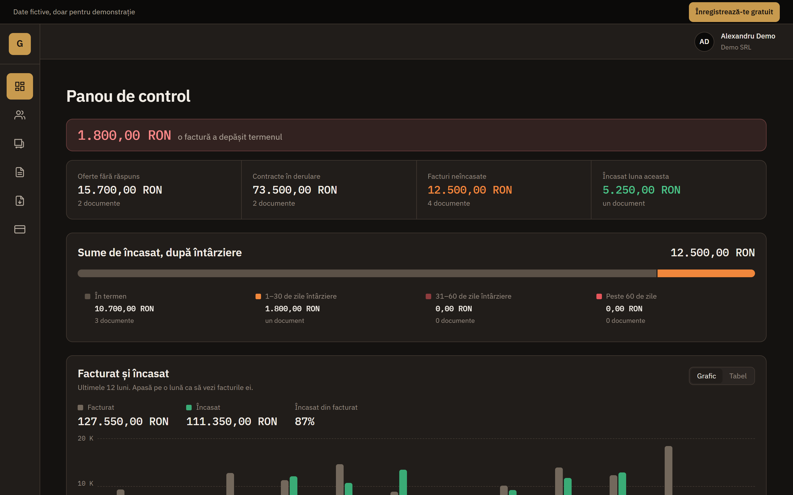
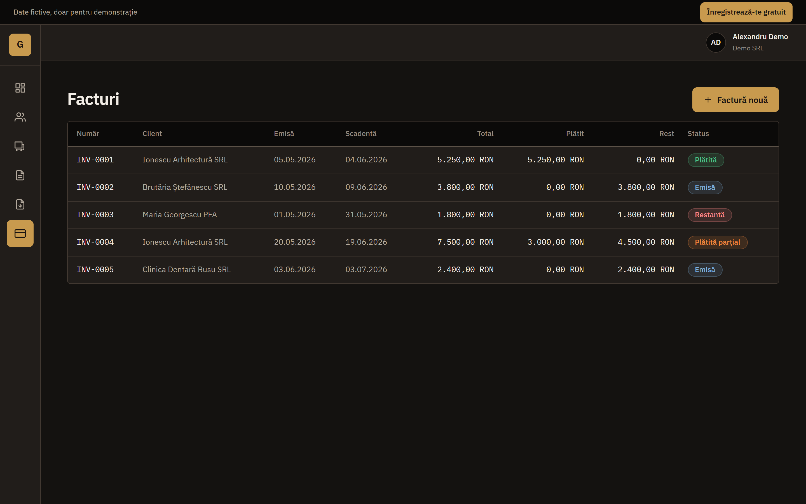
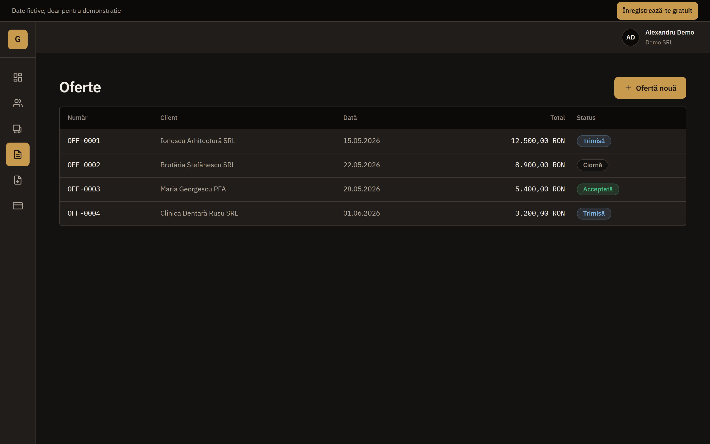
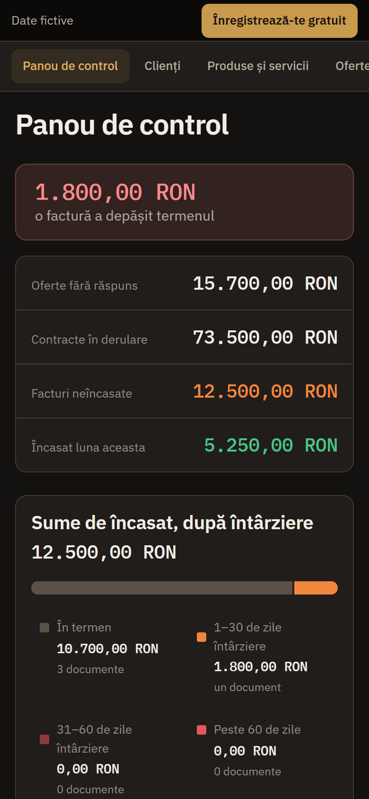
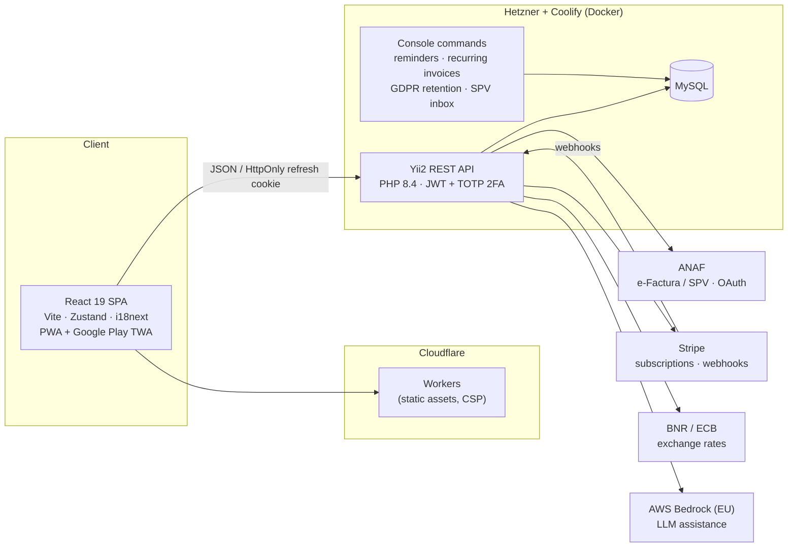

# Gestivo — invoicing & sales SaaS for Romanian small businesses

> **Showcase repository.** Gestivo's source code is private (it is a commercial product).
> This repo documents the architecture and includes a few representative, unmodified code excerpts.
> A live code walkthrough is available on request.

Gestivo replaces the Word + Excel + WhatsApp + e-mail chaos of small service firms and freelancers with one flow:

**client → offer → contract → invoice → payment → follow-up**

Built solo, end to end — product, backend, frontend, infrastructure — between March and November 2026
(282 commits). Status: feature-complete; the commercial launch is waiting on administrative steps
(company registration and ANAF SPV enrollment), not on code.

| Dashboard | Invoices |
|---|---|
|  |  |

| Offers | Mobile (PWA) |
|---|---|
|  |  |

*Screenshots from the built-in demo mode — all data is fictitious.*

---

## Architecture

**Size:** 42 controllers · 30 models · 68 migrations · 10 console commands · 69 test files ·
~52k lines of PHP and ~34k lines of JS/JSX.

## Features

**Documents & billing**
- Offers, contracts, invoices and payments with a single document lifecycle; public offer-acceptance page; sending offers over WhatsApp.
- Advance invoices automatically deducted on the final invoice; real storno (credit-note) invoices; recurring invoices.
- Company data frozen at issue time, so an issued invoice's PDF and XML never change.
- Euro invoices use the official BNR exchange rate for the invoice date.

**Romanian compliance**
- **ANAF e-Factura**: OAuth flow, UBL 2.1 / CIUS-RO XML generation, SPV submission and inbox. Validated against ANAF's public validator for B2B with VAT, non-VAT payers, 0% rate, line discounts, mixed VAT rates with a global discount, and storno.
- Per-line VAT categories (S/Z/E/AE/K/O) and the legally required VAT mentions on PDFs.
- SAGA accounting export (CSV / xlsx). e-Transport behind a feature flag.

**Payments & banking**
- Bank-statement import (CAMT.053 and MT940) with automatic payment-to-invoice matching and confidence levels.
- Stripe subscription billing: idempotent webhooks, promo codes, grace period, read-only mode after expiry, atomic plan-limit reservation.

**Teams & security**
- Multi-tenant, four roles: owner, admin, member, plus a free read-only accountant seat (with a referral program).
- JWT access tokens + refresh token in an HttpOnly cookie with revocation, TOTP 2FA, API keys.
- GDPR layer: consent, account deletion, retention cron, audit trail, log redaction.

**AI assistance** (AWS Bedrock in the EU, per-plan monthly quota, off by default)
- Draft an offer from free-text notes.
- AI-assisted bank-statement matching that proposes how one transfer splits across several invoices — always confirmed by the user.

## Engineering highlights (with code)

| File | What it shows |
|---|---|
| [`samples/VatAllocator.php`](samples/VatAllocator.php) | Allocating a header discount across VAT groups so the stored totals, the PDF and the e-Factura XML can never disagree by a ban (EN 16931 rounding rules, remainder absorbed by the last group). |
| [`samples/StripeWebhookIdempotency.php`](samples/StripeWebhookIdempotency.php) | Exactly-once webhook processing: claim row → handle → mark processed; stale-claim takeover if a worker died; never acknowledging an event nobody finished. |
| [`samples/BankMatchingService.php`](samples/BankMatchingService.php) | Bank-statement matching with confidence levels, and race-safe confirmation (`SELECT … FOR UPDATE` on the bank line and the invoice, currency and balance guards). |
| [`samples/ci.yml`](samples/ci.yml) | The GitHub Actions pipeline: PHP lint, Codeception against MySQL, "migrations really applied" and schema-drift checks, Docker image security baseline, frontend lint / Vitest / build, i18n parity, CSP hash check, dependency audits in their own job. |

The comments in these files are the originals — they record the actual bugs each design decision fixed.

## Tech stack

| Area | Technologies |
|---|---|
| Backend | PHP 8.4, Yii2 (REST), MySQL, mPDF, PhpSpreadsheet, Guzzle, Sentry |
| Frontend | React 19, Vite, React Router 7, Zustand, react-hook-form, i18next (RO/EN), Stripe Elements, PostHog |
| Integrations | ANAF e-Factura / SPV, Stripe, BNR/ECB exchange rates, AWS Bedrock |
| Testing | Codeception (unit + functional), Vitest |
| Infra | Docker (`php:8.4.27-apache`), Hetzner + Coolify, Cloudflare Workers, GitHub Actions, PWA + Trusted Web Activity (Google Play) |

## Related

- **Lămurit** — an AI spin-off: photograph an official letter (ANAF, bank, bailiff) and get a plain-Romanian explanation with deadlines and next steps. Next.js 16, Vercel AI SDK, Claude (Haiku preview → Sonnet analysis with Zod-structured output), Stripe credits, Upstash Redis.

## Author

**Mihnea Gatej** — Full-Stack Developer (PHP / Yii2 · React · TypeScript)

- E-mail: [mihnea.gatej.gb@gmail.com](mailto:mihnea.gatej.gb@gmail.com)
- Phone: +40 727 158 188
- GitHub: [github.com/Mihnea15](https://github.com/Mihnea15)
